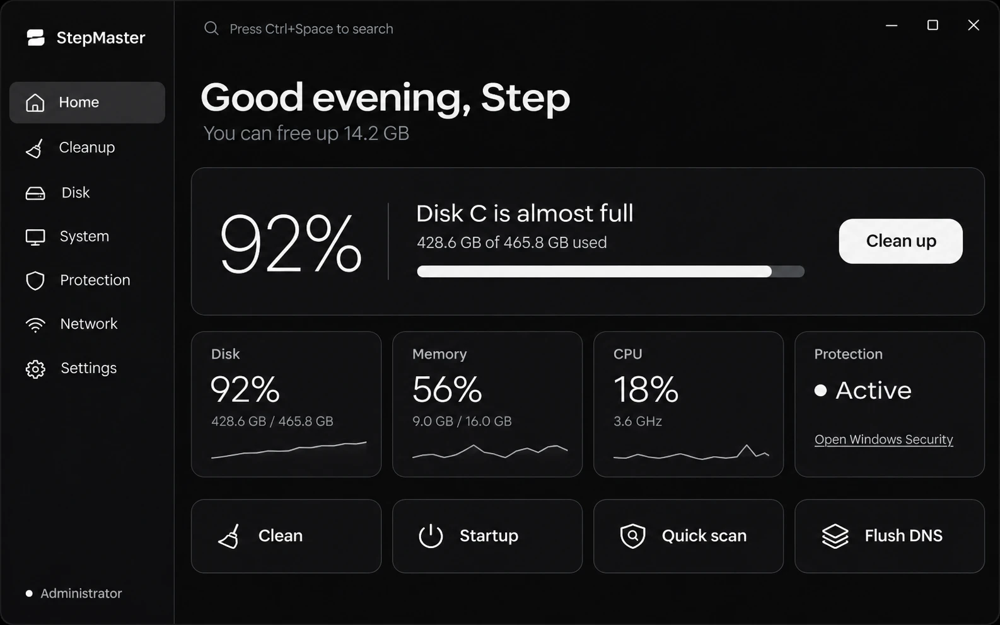

<p align="center"></p>

<h1 align="center">StepMaster</h1>

<p align="center">Все важные инструменты Windows в одной программе. Тёмный минималистичный интерфейс, один файл со встроенной установкой.</p>

<p align="center"></p>

## Скачать

Последняя версия: **[Releases → StepMaster.exe](../../releases/latest)**

Запусти `StepMaster.exe` — Windows попросит права администратора. Если появится «Неизвестный издатель», нажми «Подробнее» → «Выполнить в любом случае». Обновления программа находит и ставит сама.

Работает на Windows 10 и 11.

## Что умеет

- **Главная** — диск, память, процессор, защита и советы, что исправить.
- **Очистка** — временные файлы, кэш браузеров и шейдеров, отчёты об ошибках, файлы обновлений, корзина. Личные файлы не трогаются.
- **Диск** — что занимает место, самые большие файлы, дубликаты. Удаление только в Корзину.
- **Программы** — все программы с иконками, включая скрытые от панели управления, приложения Store и программы без установщика. Удаление с поиском остатков.
- **Система** — железо, автозагрузка, процессы, службы, точки восстановления.
- **Защита** — Microsoft Defender, брандмауэр, обновления Windows.
- **Сеть** — адаптеры, DNS, тест скорости, подключения, сохранённые пароли Wi-Fi.
- **Игры** — игровой режим одной кнопкой с полным откатом, выбор видеокарты для игр.
- **Настройки** — русский/английский, автозапуск, трей, горячая клавиша, анимации.

Поиск по всем функциям — `Ctrl+K`.

## Для разработки

React + TypeScript + Vite (интерфейс), Tauri 2 + Rust (система). Подробности — в [CLAUDE.md](CLAUDE.md).

```bash
npm install
npm run dev          # интерфейс в браузере на тестовых данных
npx tauri dev        # настоящее окно
npm run release      # сборка StepMaster.exe
```
